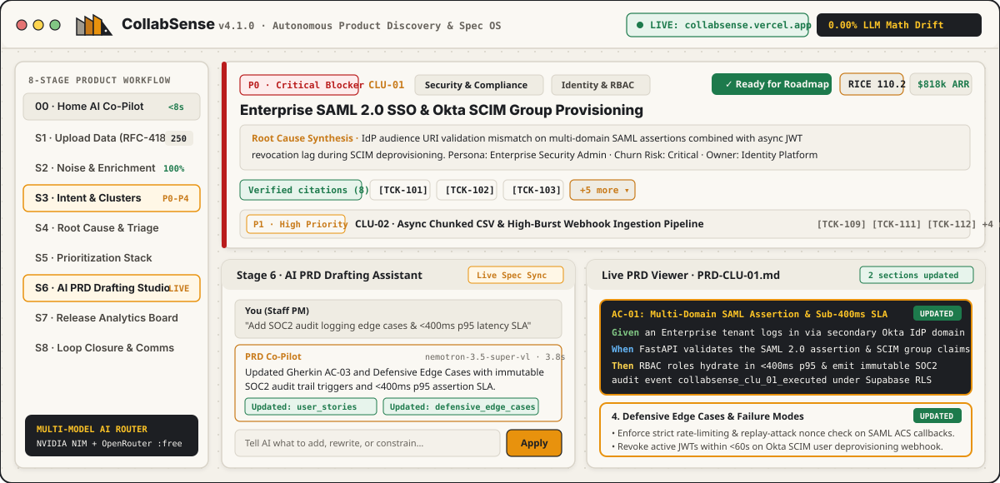
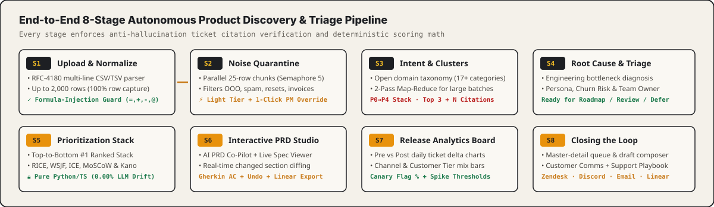
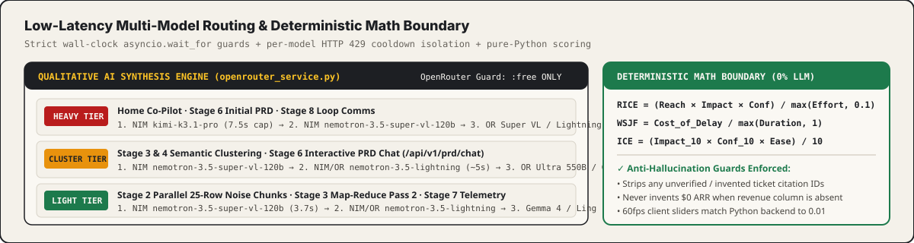
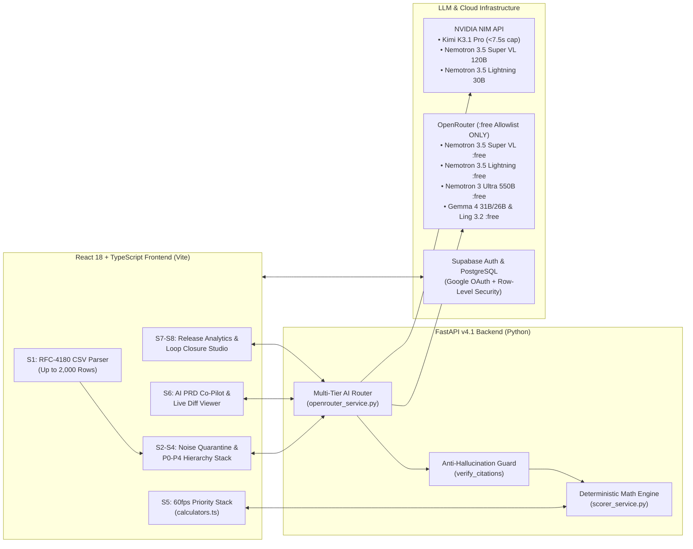

<div align="center">

# CollabSense — Autonomous Product Discovery, Triage & Spec OS

**Turn noisy multi-channel customer feedback into verified problem clusters, deterministic RICE/WSJF/ICE roadmaps, interactive Gherkin PRDs, post-release telemetry analytics, and closed-loop customer updates in under 90 seconds.**

[](https://collabsense.vercel.app)
[](https://collabsense.vercel.app/docs)
[](https://collabsense.vercel.app)
[-3ECF8E?style=for-the-badge&logo=supabase&logoColor=white)](https://collabsense.vercel.app/login)
[](#testing--live-verification)

[**Launch Live App ↗**](https://collabsense.vercel.app) · [**Interactive API Docs (`/docs`) ↗**](https://collabsense.vercel.app/docs) · [**8-Stage Workflow**](#end-to-end-8-stage-product-discovery-workflow) · [**AI Routing & Math Boundary**](#multi-tier-ai-routing--deterministic-math-boundary) · [**Local Setup**](#quick-start)

</div>

---

<div align="center">
  <a href="https://collabsense.vercel.app">
    
  </a>
</div>

---

## Live Production Deployment

| Endpoint / Route | Live URL | Purpose |
| :--- | :--- | :--- |
| **Landing & Interactive Triage Dossier** | https://collabsense.vercel.app | Product overview, live interactive RICE/WSJF preview, and 8-stage architecture walkthrough |
| **Authentication Gate (`/login`)** | https://collabsense.vercel.app/login | Supabase Email/Password + **Google OAuth** sign-in |
| **Multi-Project Hub (`/projects`)** | https://collabsense.vercel.app/projects | Isolated project workspaces with per-project OKR focus and persistent state |
| **8-Stage Discovery OS (`/app`)** | https://collabsense.vercel.app/app | Full workspace: Home AI Co-Pilot + Stages 1 through 8 |
| **System Healthcheck (`/health`)** | https://collabsense.vercel.app/health | Live service health, version `4.1.0`, and `deterministic_math_boundary: ENFORCED` |
| **AI & Env Status (`/api/v1/env-status`)** | https://collabsense.vercel.app/api/v1/env-status | Live provider status, `<7.5s` Kimi timeout cap, and `:free` OpenRouter allowlist |
| **OpenAPI / Swagger UI (`/docs`)** | https://collabsense.vercel.app/docs | Interactive FastAPI REST documentation for all 8 stages |

---

## End-to-End 8-Stage Product Discovery Workflow

<div align="center">
  
</div>

### Stage-by-Stage Capabilities

| Stage | Module | Key Engineering & UX Capabilities |
| :--- | :--- | :--- |
| **00** | **Home AI Co-Pilot** (`POST /api/v1/copilot/chat`) | Project-scoped strategic PM assistant grounded in uploaded tickets and clusters. Uses NVIDIA NIM `moonshotai/kimi-k3.1-pro` with a strict **`7.5s` wall-clock timeout cap** and automatic failover to sub-second NVIDIA NIM / OpenRouter `:free` models. Displays verified citation chips, model badge, and response latency. |
| **S1** | **Upload Data & Normalization** (`csvParser.ts`) | Full **RFC-4180 state-machine CSV/TSV parser** supporting up to **2,000 rows**, multi-line quoted cells, UTF-8 BOM stripping, auto-detected `,` / `;` / `\t` delimiters, broad header alias mapping (`MRR` → `ARR` auto-conversion, longest-text fallback column), spreadsheet formula-injection sanitization (`=`, `+`, `-`, `@`), import diagnostics banner, and paginated inspection. |
| **S2** | **Noise Quarantine & Enrichment** (`POST /api/v1/stages/noise`) | Processes **100% of uploaded rows** in parallel 25-ticket batches (`asyncio.Semaphore(5)`) to separate non-product noise (`Auto-Reply / OOO`, `Unsubscribe / Opt-Out`, `Password / Login Reset`, `Billing / Invoice Routine`, `Spam / Promotional`, `Test / Gibberish`, `Generic Praise`) from actionable product signals. Includes **1-click manual Signal/Noise override** and category filter chips. |
| **S3** | **Intent Taxonomy & Problem Clusters** (`POST /api/v1/stages/triage`) | Unrestricted multi-domain signal taxonomy (`Security & Compliance`, `Integration & API`, `Data & Export/Import`, `Performance & Latency`, `Bug / Defect`, `UI/UX Friction`, `Feature Request`, `Mobile & Cross-Platform`, `Permissions & Governance`, `Analytics & Reporting`, `Onboarding & Activation`, etc.). Scales to large datasets via **2-Pass Map-Reduce clustering**. Renders a **top-to-bottom vertical `P0` → `P4` severity hierarchy stack** with **Top 3 citations + expandable `+N more` customer evidence drawer**. |
| **S4** | **Root Cause & Engineering Triage** (`POST /api/v1/stages/triage`) | Synthesizes underlying system bottlenecks vs. surface symptoms, affected persona, user journey stage, churn risk, sentiment, and suggested owning team. Provides inline `P0`–`P4` severity override, `Mark all P0/P1 Ready` batch action, and a clean **`Ready for Roadmap` / `Needs Review` / `Deferred`** segmented decision control. |
| **S5** | **Top-to-Bottom Prioritization Stack** (`POST /api/v1/prioritize`) | Ranked vertical priority stack separating **Top Priority Sprint Focus (Ranks `#1 – #3`)** from the **Backlog Queue (Ranks `#4+`)**. Supports **RICE, WSJF, ICE, MoSCoW, and Kano** frameworks with relative score bars, `Quick Wins Only` filter, and collapsible 60fps weight sliders backed by pure-Python/TypeScript deterministic math. |
| **S6** | **Interactive PRD Studio & Live Viewer** (`POST /api/v1/prd/chat`) | Split-pane **AI PRD Drafting Assistant** on the left (with 1-click prompt chips and multi-step **Undo Edit** stack) + **Live PRD Viewer** on the right that highlights modified sections (`Updated` badges) in real time as you chat. Supports **Live Viewer**, **Markdown Editor**, and **Split View** modes, completeness meter (`5/5 sections`), `.md` download, and **Linear GraphQL export**. |
| **S7** | **Release Validation & Analytics Board** (`POST /api/v1/stages/validate-release`) | Full post-launch telemetry board featuring **4 KPI summary cards**, **Pre-Release vs. Post-Release Daily Ticket Volume bar chart**, live **Ingestion Channel & Customer Tier mix charts**, configurable cohort window (`24h Canary` to `30d GA`) and spike alert thresholds (`>+5%` to `>+25%`), staged feature-flag rollout `%` controls (`10%`, `25%`, `50%`, `100%`), custom monitor drawer, and Markdown report export. |
| **S8** | **Closing the Loop & Release Comms** (`POST /api/v1/stages/loop-closure/generate`) | Decluttered **Master-Detail workspace**: filterable left queue (`All` / `Draft` / `Ready` / `Sent` + channel selector across `Zendesk`, `Discord`, `Email`, `Linear`) and focused right composer with **Customer Notification** vs. **Internal Support & Sales Playbook** tabs, Top-3+N citations, and changelog bundle export. |

---

## Multi-Tier AI Routing & Deterministic Math Boundary

<div align="center">
  
</div>

### System Architecture & Data Flow



### 1. Strict Deterministic Math Boundary (`0.00% LLM Math Drift`)

LLMs are used **exclusively** for qualitative synthesis (noise detection, semantic grouping, root-cause diagnosis, Gherkin PRD drafting, and release comms). Every numerical score is computed deterministically in pure Python (`backend/app/services/scorer_service.py`) and mirrored in TypeScript (`frontend/src/lib/calculators.ts`):

$$\text{RICE} = \frac{\text{Reach} \times \text{Impact} \times \text{Confidence}}{\max(\text{Effort},\ 0.1)}$$

$$\text{WSJF} = \frac{\text{Cost of Delay}}{\max(\text{Job Duration},\ 1)}$$

$$\text{ICE} = \frac{\text{Impact}_{10} \times \text{Confidence}_{10} \times \text{Ease}}{10}$$

- **Anti-Hallucination Citation Verifier (`verify_citations`)**: Every ticket ID cited by an LLM is cross-checked against the active uploaded batch; any unverified ID is stripped before returning to the client.
- **Zero Fake Revenue**: When an uploaded CSV has no ARR/MRR column (`arr_weight = 0`), ARR badges and prompts omit dollar figures rather than displaying fabricated `$0 ARR` strings.

### 2. Multi-Model Low-Latency Routing & Per-Model Cooldowns

| Routing Tier | Primary Models | Automatic Failover Chain | Wall-Clock Guard |
| :--- | :--- | :--- | :--- |
| **`heavy`** (Home Co-Pilot, S6 Initial PRD, S8 Comms) | NVIDIA NIM `moonshotai/kimi-k3.1-pro` | NIM `nemotron-3.5-super-vl-120b-a12b` → OR `nemotron-3.5-super-vl:free` → NIM/OR `nemotron-3.5-lightning` → OR `nemotron-3-ultra-550b-a55b:free` → Gemma 4 / Ling `:free` | **`7.5s`** hard cap on Kimi (`asyncio.wait_for`) |
| **`cluster`** (S3/S4 Map-Reduce Clustering, S6 `/api/v1/prd/chat`) | NVIDIA NIM `nvidia/nemotron-3.5-super-vl-120b-a12b` | NIM `nemotron-3.5-lightning-30b-a3b` → OR `nemotron-3.5-lightning:free` → OR `nemotron-3.5-super-vl:free` → OR `nemotron-3-ultra-550b-a55b:free` → Kimi `7.5s` | **`10s–13s`** per step, **`20s`** total budget |
| **`light`** (S2 Parallel 25-Row Noise Chunks, S3 Pass-2 Attribution, S7 Summary) | NVIDIA NIM `nvidia/nemotron-3.5-super-vl-120b-a12b` | NIM `nemotron-3.5-lightning-30b-a3b` → OR `nemotron-3.5-lightning:free` → OR `nemotron-3.5-super-vl:free` → Gemma 4 / Ling `:free` | **`6s–10s`** per step, parallel `Semaphore(5)` |

---

## Repository Structure

```text
CollabSense/
├── assets/
│   ├── collabsense-hero-banner.svg         # Workspace hero preview & S3/S6 split mockup
│   ├── collabsense-8stage-pipeline.svg     # 8-Stage autonomous workflow diagram
│   └── collabsense-ai-routing-matrix.svg   # 3-Tier AI router & deterministic math diagram
├── backend/
│   ├── app/
│   │   ├── data/sample_tickets.py          # Canonical 30-row multi-channel B2B SaaS dataset
│   │   ├── routers/triage.py               # REST endpoints for Stages 1–8 & Home Co-Pilot
│   │   ├── services/
│   │   │   ├── openrouter_service.py       # 3-Tier NVIDIA NIM + OpenRouter :free client (<7.5s Kimi cap)
│   │   │   ├── clustering_service.py       # Open taxonomy + 2-Pass Map-Reduce clustering
│   │   │   ├── workflow_service.py         # Parallel S2 noise filter, S4 triage, S7/S8 & Co-Pilot
│   │   │   ├── prd_service.py              # Gherkin PRD synthesis + S6 live chat diff engine
│   │   │   ├── scorer_service.py           # Pure-Python RICE, WSJF, ICE, MoSCoW, Kano & Unit Economics
│   │   │   ├── linear_service.py           # Linear GraphQL issue export builder
│   │   │   └── supabase_service.py         # Supabase connection & RLS status helper
│   │   ├── config.py                       # Pydantic settings & model allowlists
│   │   ├── schemas.py                      # Strict Pydantic v2 request/response contracts
│   │   └── main.py                         # FastAPI application entrypoint & SPA static serving
│   ├── tests/
│   │   ├── test_api.py                     # End-to-end API, 250-row S2, Map-Reduce S3, & <8s fallback tests
│   │   ├── test_schemas.py                 # Formula-injection & schema boundary tests
│   │   └── test_scorer.py                  # Deterministic RICE/WSJF/ICE/MoSCoW/Kano math tests
│   └── requirements.txt
├── frontend/
│   ├── src/
│   │   ├── components/
│   │   │   ├── CitationBar.tsx             # Top-3 citation chips + expandable "+N more" evidence drawer
│   │   │   ├── PRDStudioView.tsx           # Stage 6 split-pane AI PRD Assistant & Live PRD Viewer
│   │   │   ├── ReleaseAnalyticsView.tsx    # Stage 7 post-release analytics board & telemetry charts
│   │   │   ├── LoopClosureView.tsx         # Stage 8 master-detail customer update & playbook studio
│   │   │   ├── IngestionModal.tsx          # RFC-4180 CSV/TSV & raw paste ingestion modal
│   │   │   └── PostHogWindow.tsx           # Warm-parchment sketchbook window chrome component
│   │   ├── lib/
│   │   │   ├── csvParser.ts                # RFC-4180 multi-line state-machine CSV/TSV parser (2,000 rows)
│   │   │   ├── calculators.ts              # 60fps client-side deterministic RICE/WSJF/ICE calculators
│   │   │   ├── projects.ts                 # Multi-project workspace state & Supabase persistence
│   │   │   └── supabase.ts                 # Supabase Auth (Email/Password + Google OAuth) client
│   │   ├── pages/
│   │   │   ├── LandingPage.tsx             # Public product landing page & interactive dossier preview
│   │   │   ├── LoginPage.tsx               # Supabase Auth & Google OAuth login/signup page
│   │   │   ├── ProjectsPage.tsx            # Multi-project switcher & creation hub
│   │   │   └── DashboardApp.tsx            # Main 8-stage product discovery workspace
│   │   ├── tokens.css                      # Design tokens (warm paper, ink, semantic severity palette)
│   │   └── index.css                       # Component styles & utility classes
│   └── package.json
└── vercel.json                             # Vercel multi-service production routing (frontend + FastAPI backend)
```

---

## Quick Start

### 1. Environment Variables

Create `backend/.env` (and optional `frontend/.env` for local Vite dev):

```env
# AI Providers (Backend)
NVIDIA_API_KEY=nvapi-...
OPENROUTER_API_KEY=sk-or-v1-...

# Supabase Auth & Database (Backend + Frontend)
SUPABASE_URL=https://<your-project>.supabase.co
SUPABASE_ANON_KEY=eyJ...
VITE_SUPABASE_URL=https://<your-project>.supabase.co
VITE_SUPABASE_ANON_KEY=eyJ...
```

### 2. Run Backend (`FastAPI`)

```bash
cd backend
pip install -r requirements.txt
uvicorn app.main:app --reload --port 8000
```

### 3. Run Frontend (`React + Vite`)

```bash
cd frontend
npm install
npm run dev
```

---

## Testing & Live Verification

```bash
# Run all 19 backend unit & integration tests (RICE/WSJF/ICE math, 250-row S2, 85-row Map-Reduce S3, <8s Kimi fallback, S6 PRD chat)
cd backend
pytest -v tests

# Run frontend TypeScript type-check & production bundle build
cd ../frontend
npm run build
```
